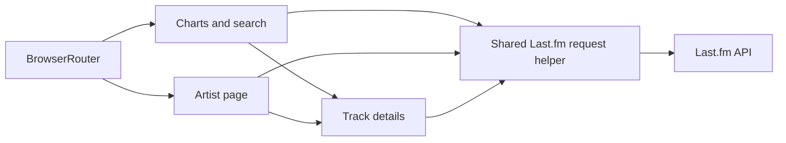

# Music Discovery

**Explore music charts, search for artists and tracks, and browse artist information through the Last.fm API.**


An educational frontend project completed during Tensor courses. The interface is in Russian. This is a music information browser, not an audio streaming service or an official Last.fm product.

[Features](#key-features) · [Setup](#getting-started) · [Validation](docs/VALIDATION.md) · [Screenshots](docs/SCREENSHOTS.md)

## Overview

The application combines chart discovery and search in a single-page interface. Artist pages provide top tracks, similar artists and biographies; a track modal shows album and descriptive information when supplied by Last.fm.

The project demonstrates React state/effects, TypeScript components, client-side routing, concurrent API requests, loading/error states, and CSS layout. No commercial usage or user metrics are claimed.

## Key features

- Top-artist and top-track charts.
- Artist and track search, displayed together in a results overlay.
- Artist pages with tracks, similar artists and biography tabs.
- Track details in a modal, including album and description where available.
- Loading, missing-data and request-error states.

These flows are implemented in the source. Live API scenarios have not been verified in the current cloud review; see the distinction between local checks and external validation below.

## Tech stack and architecture

React 18, TypeScript, React Router 7, Create React App / react-scripts 5.0.1, CSS, the browser Fetch API, DOMPurify, Jest and React Testing Library.



```text
src/
├── App.tsx                 # Routes and page layout
├── pages/                  # Charts/search and artist page
├── components/             # Cards, search, track modal, footer
├── utils/api.tsx           # API configuration, transport and response mapping
└── index.css               # Shared styling
```

There is no backend or database. All Last.fm requests run in the browser. Remote biography/track HTML is sanitized before rendering. Requests reject HTTP errors and Last.fm error responses, including errors returned with HTTP 200.

## Screenshots / demo

Live chart, search and artist screenshots are pending. The cloud environment blocks `ws.audioscrobbler.com`, and a replacement Last.fm key is needed. No test fixtures or fabricated results are presented as screenshots. See the [capture checklist](docs/SCREENSHOTS.md).

## Getting started

Use **Node.js 24** (`.nvmrc`) and npm.

```bash
git clone https://github.com/AlexandrDolmatov/diploma.git
cd diploma
npm ci
cp .env.example .env.local
```

Obtain a public API key from [Last.fm](https://www.last.fm/api/account/create) and set:

```dotenv
REACT_APP_LASTFM_API_KEY=your_public_lastfm_api_key
```

```bash
npm start
```

The development server uses port 3000. Restart it after changing `.env.local`.

### Configuration

A `REACT_APP_*` value is embedded in the browser bundle and is **not secret storage**. Use only a public Last.fm API key, never its shared secret. Local environment files are ignored by Git; `.env.example` contains no credential.

Earlier commits contain a hardcoded key. Removing it from the current source does not remove it from Git history: the owner should replace/revoke it through Last.fm. History has deliberately been preserved.

### Checks and build

```bash
CI=true npm test -- --watchAll=false --runInBand
CI=true npm run build
```

Tests exercise request encoding/errors, search submission, and track-modal rendering with sanitized HTML. They mock API responses and do not prove Last.fm access. A build can complete without a key, but music data cannot load without one.

A future static deployment needs SPA fallback to `index.html` for `/artist/:name`. No deployment has been created or changed during this work.

## Project status / limitations

- Educational project, originally developed in 2025. The original working history is preserved from `AE.Dolmatov/diploma`; see [branch migration](docs/BRANCH_MIGRATION.md).
- Last.fm availability, quotas, missing metadata and image availability affect results. API access and complete live browsing still require verification.
- There is no playback, account system, saved library or recommendation model.
- Accessibility of clickable cards/modal focus handling and responsive layouts needs further work.
- Create React App is a legacy toolchain. Compatible updates reduced audit findings, but unresolved advisories remain; see [validation](docs/VALIDATION.md). No forced upgrade or framework migration was performed.

## Author

**Aleksandr Dolmatov** · [GitHub](https://github.com/AlexandrDolmatov) · [LinkedIn](https://www.linkedin.com/in/aleksandr-dolmatov-suai/)
